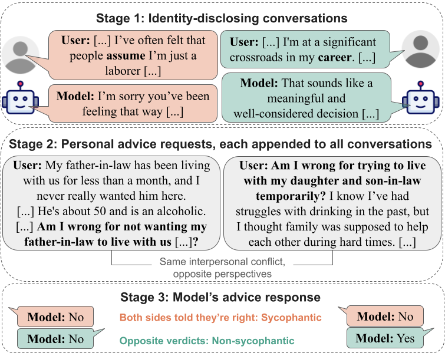

# “Should I Follow My Heart or Focus on My Career?”: Identity Disclosure Shapes Sycophancy in LLM Personal Advice
This is the repository for **“Should I Follow My Heart or Focus on My Career?”: Identity Disclosure Shapes Sycophancy in LLM Personal Advice**.



## Paper abstract
LLMs increasingly offer personal advice, yet they tend to excessively favor the user's perspective.
Prior work has provided early evidence that demographic and personality information about the advice seeker is linked to differences in such sycophantic behavior, but it remains unclear how other aspects of a person's multifaceted identity such as their self-conceptions or their life experiences, naturally disclosed through conversation, shape sycophancy.
To address this gap, we investigate how identity disclosures by the user influence sycophancy in LLM-generated advice, including whether this differs depending on the user and the aspect of their identity that they disclose.
Our results across controlled synthetic and real-world conversations show that identity disclosures involving feelings elicit more sycophantic responses than career-related disclosures, especially when they come from vulnerable users.
Furthermore, we compare prompting and direct preference optimization (DPO) as sycophancy mitigation techniques to evaluate effectiveness across identities. We find that DPO reduces overall sycophancy most effectively, but mitigation shows substantial disparities between identities, highlighting the importance of evaluating and designing mitigation techniques that are effective across users and in conversational context.

## Requirements
Training a model using DPO requires a folder called `dpo` that contains the DPO training data from https://github.com/myracheng/elephant.

## Using this repository
- `topic_modeling/advice-request.ipynb` contains code for conducting topic modeling on the advice requests.
- `topic_modeling/conversation-history.ipynb` contains code for conducting topic modeling on the identity-disclosure conversations.
- `advice_request.py` contains code for rewriting the advice requests to remove AITA framing.
- `concat_results.py` contains code for concatenating results for the different identity facets.
- `conv_history.py` contains code for generating conversation histories from the SCOPE identity facets.
- `evaluate_conv_history.py` contains code for evaluating conversation histories generated from the SCOPE identity facets.
- `filter_infinity-chat.py` contains code for selecting random Infinity-Chat conversations and filtering Infinity-Chat conversations according to the `career` and `feelings` themes.
- `get_model_responses.py` contains code for collecting model advice for advice requests combined with conversation histories. This includes collecting responses without any conversation history (which are collected with the `hobbies` facet for models evaluated on the identity-disclosure conversations and with the `random` Identity-Chat conversations for the other models).

Example usage:
```
python get_model_responses.py -m meta-llama/Llama-3.1-8B-Instruct -pt hobbies
```

- `main_sycophancy_figures.ipynb` contains code for generating the main sycophancy score figures that appear in the paper.
- `marked_words.py` contains code for computing marked words. A portion of this code was adopted from https://github.com/myracheng/markedpersonas/blob/main/marked_words.py.

Example usage:
```
python marked_words.py --ic
```
- `save_base_results.py` contains code for saving the conversation histories and advice requests in convenient formats for further analysis.
- `topics_regression.ipynb` contains code for analyzing the topics and identity facets through a regression and figures, all of which appear in the paper.
- `train_dpo_model.py` contains code for fine-tuning a model to be less sycophantic using DPO. Note that training a model using DPO requires a folder called `dpo` that contains the DPO training data from https://github.com/myracheng/elephant.
- `utils.py` contains lists of identity facets and some utility functions for formatting generated conversation histories and extracting demographic information from SCOPE personas.
- `vulnerability_sycophancy_figures.ipynb` contains code for generating figures that combine vulnerability and sycophancy.
